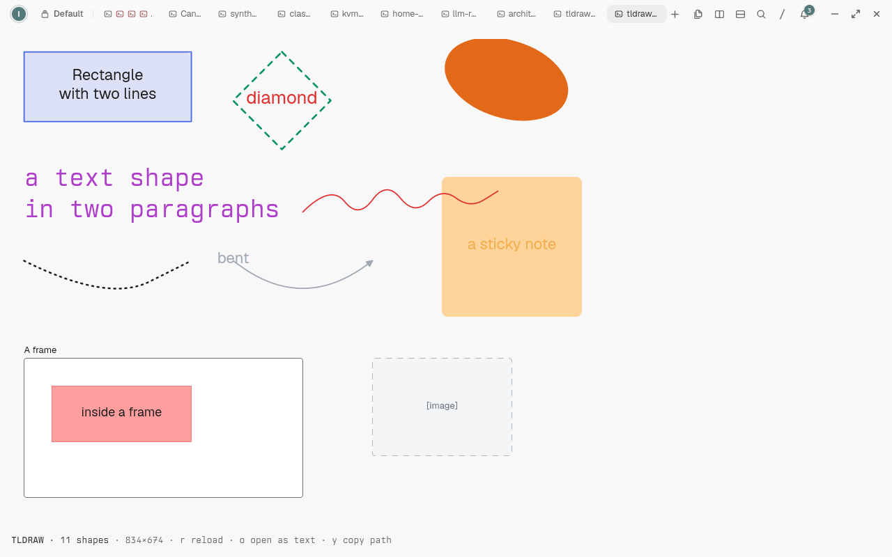

# Canvas Viewer

Open `.excalidraw` and `.tldraw` drawings inside [Tern](https://stencil.so/tern)
as a rendered picture in a block.



Tern has no reader for either format — a `.excalidraw` file opens as its JSON
source. Canvas Viewer claims those files, reads the scene in the plugin's host
half, draws it as an SVG, and hands that SVG to Tern's `image` kind. Nothing is
converted on disk, no external tool runs, and the file is never written.

## Install

```sh
tern plugin install github.com/iacore/tern-canvas-viewer
```

To work on it, link a checkout instead so Tern reloads it on every save:

```sh
tern plugin link ~/computing/terminal/tern-canvas-viewer
```

Requires Tern 0.8.4 or newer.

## Use

- Open the file any way you like — the Files pane, the palette, a path clicked
  in a terminal, `tern open drawing.excalidraw`, or **Open with › Canvas
  Viewer**. A plain open of `*.excalidraw` or `*.tldraw` goes to the viewer.
- The palette command **Toggle canvas preview for .excalidraw and .tldraw
  opens** switches that off, so those files open in the editor again; `Open
  with` keeps working either way.
- An open that asks for a line (`file.rs:12`) always goes to the editor.

Keys and gestures in the block:

| Key | Does |
| --- | --- |
| `r` | Read the file again |
| `o` | Open the file as text, in a file block |
| `y` | Copy the file's path |
| click the picture | Zoom it, as any Tern image zooms |

A file that changes on disk is picked up on its own: the block re-reads it
while it stays under 1 MiB, and redraws when its content differs.

## What it draws

Excalidraw scenes (`exportToFile` JSON, `type: "excalidraw"`):

| Element | Drawn as |
| --- | --- |
| `rectangle`, `stickynote` | A box, rounded by its `roundness` |
| `ellipse` | A box drawn as two arcs |
| `diamond` | A four-point polygon |
| `line`, `arrow` (including `polygon` and `elbowed`) | A path through `points`, with heads for `arrow`, `triangle`, `triangle_outline`, `circle`, `circle_outline`, `diamond`, `diamond_outline`, `bar` |
| `freedraw` | A smoothed path through `points` |
| `text` | One text node per line, placed by `textAlign`, sized and coloured as written |
| `frame`, `magicframe` | An outline, with the frame's name above it |
| `image`, `embeddable`, `iframe` | A dashed box labeled with its size or kind |

tldraw documents, both the file format (`records`) and a store snapshot
(`document.store`): `geo` (rectangle, ellipse, oval, diamond, rhombus,
triangle, trapezoid, pentagon, hexagon, octagon, star, x-box, check-box),
`text`, `note`, `draw` and `highlight` (their base64 point stream is decoded:
the first point as Float32, the rest as Float16 deltas), `line` (spline or
straight, points ordered by their fractional index), `arrow` (straight or bent,
with heads), `frame` and its children, `image`, `video`, `bookmark`, `embed`.
Shapes on one page are ordered by their `index`, with a frame's children above
the frame and the frame itself beneath the page; several pages are drawn side
by side with their names above them.

Colour comes from the file: Excalidraw's own hex values, and tldraw's named
palette resolved through the light palette of `DEFAULT_THEME` (a tldraw file
records colour names, not what they look like, and does not say which theme it
was drawn in).

## How it works

`host.luau` is the block. It reads the file, picks a reader by extension (or by
the document itself when the extension says nothing), lowers the scene into a
small shape vocabulary in `scene.luau`, renders that as SVG, and sends the SVG
with `cx:blob(svg, "image/svg+xml")` for an `image` node. `window.luau` routes
opens and holds the toggle. `excalidraw.luau`, `tldraw.luau`, `vecs.luau` and
`scene.luau` are the readers and the writer.

Tern mounts an SVG blob as real SVG elements, so the writer stays inside what
its renderer draws. Measured on 0.8.4: `path` (including arcs, cubics and
quadratics), `rect`, `text`, `g` with a rotation or translation transform,
`opacity`, `fill-opacity`, `stroke-dasharray`, `stroke-linecap` and
`stroke-linejoin` all render; `<ellipse>` and `<polyline>` are dropped, so
ellipses are two arc subpaths and every stroke is a path.

## Limits

- An embedded image is a box with its size, not the picture: Excalidraw keeps
  images in the file's `files` as base64, which does not fit Tern's 256 KiB SVG
  blob, and tldraw keeps them in asset records.
- Hachure, cross-hatch, zigzag (`fillStyle`) and tldraw's `pattern` fill are a
  light wash of the colour, not hatching.
- Hand-drawn faces (Virgil, Excalifont, tldraw's `draw`) fall back to the
  terminal's sans-serif.
- A scene drawable only above Tern's 256 KiB SVG limit is cut: the block draws
  what fits, from the back, and says how many shapes it left out.
- The viewer is read-only. Edits in Tern are not written back.
- tldraw text sizes and label padding follow tldraw's constants, so a label may
  wrap differently than it does in tldraw.

## Development

```sh
tern plugin types .                # writes tern.d.luau for luau-lsp
tern plugin link .                 # Tern reloads on save
tern plugin reload
tern plugin list
```

`tests/sample.excalidraw` and `tests/sample.tldraw` are hand-written scenes
that cover every element kind the readers handle; the tldraw sample's `draw`
segment was encoded by tldraw's own `b64Vecs` scheme. Rendered against, but not
bundled here: [DataDog/go-profiler-notes guide.excalidraw](https://github.com/DataDog/go-profiler-notes/blob/master/guide.excalidraw),
[ralsina/kv kvm.excalidraw](https://github.com/ralsina/kv/blob/main/kvm.excalidraw),
[assareh/home-lab home-lab.excalidraw](https://github.com/assareh/home-lab/blob/main/home-lab.excalidraw),
[ardanlabs/service6-video class.excalidraw](https://github.com/ardanlabs/service6-video/blob/main/class.excalidraw)
and [1vav/embedded-editor-for-claude-code architecture.tldraw](https://github.com/1vav/embedded-editor-for-claude-code/blob/main/architecture.tldraw).

## Licence

BSD 2-Clause. See [COPYING.md](COPYING.md).